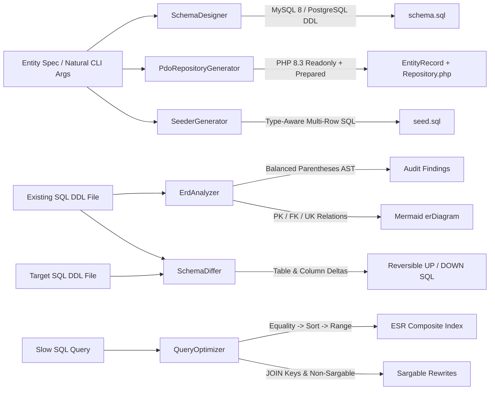

# 🏛️ Nemr DB Architect `v3.0.0` (Sovereign Edition)

### *Autonomous Relational Database Architecture, Reversible Schema Differ, ESR Index Optimizer, PHP 8.3 PDO Repository Generator & DDL Auditing Suite*

[](https://github.com/ElNeMeR70/nemr-db-architect/releases)
[](https://python.org)
[](pyproject.toml)
[](tests/test_db_architect.py)
[](LICENSE)

---

## 📖 Executive Overview | نظرة عامة معمّقة

**English:**  
**Nemr DB Architect** is a zero-dependency database engineering operating system built on pure Python stdlib. It eliminates the most expensive sources of production outages in SaaS backends: slow full-table SQL scans, missing composite indexes, unindexed foreign keys, floating-point currency rounding bugs, unsafe SQL concatenations in PHP, and broken manual migrations. Every engine operates statically offline — with zero third-party packages — making it instant to run locally, in CI/CD pipelines, or inside AI coding agents.

**بالعربية (الشرح الهندسي الكامل):**  
أداة **`nemr-db-architect`** هي منظومة هندسة قواعد بيانات متكاملة صُممت خصيصاً لمهندسي الباك إند ومطوري PHP/Python/SaaS لتلافي أخطر مشاكل الأداء والأمان في قواعد البيانات (`MySQL 8` و `PostgreSQL`) قبل وصولها لبيئة الإنتاج. بدلاً من الاعتماد على أدوات ثقيلة أو تخمين الفهارس يدوياً، تقوم المنظومة بتحليل ملفات الـ SQL DDL، واستنباط مخططات العلاقات (**Mermaid ERD**)، ومقارنة نسختين من قاعدة البيانات لإنتاج **Migrations عكسية (UP/DOWN)**، وإعادة ترتيب الفهارس المركبة وفق قاعدة **ESR العالمية**، وتوليد مستودعات **PHP 8.3 PDO** محصنة بالكامل ضد ثغرات حقن قواعد البيانات (`SQL Injection`).

---

## 🏗️ System Architecture | معمارية النظام الداخلية



---

## 🔬 Deep Dive into Core Engines | شرح تفصيلي للمحركات الداخلية

### 1. Balanced-Parenthesis SQL Parser & Linter ([`core/erd_analyzer.py`](core/erd_analyzer.py))
Naive regex parsers break on real-world SQL DDL because clauses like `DECIMAL(12, 2)`, `VARCHAR(255)`, and `REFERENCES users (id)` contain commas and parentheses inside `CREATE TABLE (...)`.  
`ErdAnalyzer` solves this using a **two-stage lexical scanner**:
1. **`_iter_create_tables()`**: Walks character-by-character tracking parenthesis depth (`depth`), single-quoted literals, and double-quoted identifiers so every table block is isolated with 100% precision.
2. **`_split_top_level_clauses()`**: Splits top-level comma boundaries (`depth == 0`) inside the table body to cleanly separate column definitions, `PRIMARY KEY`, `FOREIGN KEY ... REFERENCES`, inline `INDEX`/`KEY`, and table storage options (`ENGINE`, `CHARSET`).

**Production Hazards Audited Automatically (`audit_schema`):**
- `MISSING_PRIMARY_KEY` (**CRITICAL**): Detects InnoDB tables lacking a clustered Primary Key.
- `MISSING_FK_INDEX` (**HIGH**): Detects foreign-key columns without an accompanying secondary index (preventing parent-table lock escalation and `JOIN` full scans).
- `FLOAT_CURRENCY_PRECISION` (**HIGH**): Catches monetary columns (`price`, `amount`, `total`, `balance`, `cost`, `salary`) typed as `FLOAT` or `DOUBLE` instead of exact fixed-point `DECIMAL`/`NUMERIC`.
- `LEGACY_ENGINE_OR_CHARSET` (**MEDIUM**): Flags `MyISAM` (no crash safety / no transactions) and 3-byte `utf8`/`utf8mb3` (drops 4-byte Unicode & emojis).

### 2. Deterministic ESR Query Optimizer ([`core/query_optimizer.py`](core/query_optimizer.py))
Database B-Tree composite indexes depend critically on column order. Random `set()` ordering destroys index efficiency.  
`QueryOptimizer.analyze_query()` implements the industry-standard **ESR Rule**:
1. **Equality (`=`, `IN`)** columns are placed **first** in deterministic query appearance order to narrow the B-Tree slice immediately.
2. **Sort (`ORDER BY`)** columns come **second** so rows are already sorted in index order, eliminating `Using filesort`.
3. **Range (`>`, `<`, `>=`, `<=`, `BETWEEN`, `LIKE`)** columns come **last**, avoiding premature B-Tree range termination.

Additionally, `QueryOptimizer` parses multi-table `JOIN ... ON a.col = b.col` clauses (resolving table aliases automatically) to emit dedicated foreign-key `join_recommendations`, and flags **non-sargable** predicates (`YEAR(created_at) = 2026`, `DATE(col) = '...'`, `LOWER(col)`) with exact sargable range rewrites!

### 3. Reversible Schema Differ ([`core/schema_differ.py`](core/schema_differ.py))
Compares any `old_schema.sql` against `new_schema.sql` and calculates:
- Newly added tables (`UP: CREATE TABLE ...`, `DOWN: DROP TABLE IF EXISTS ...`).
- Dropped tables (`UP: DROP TABLE IF EXISTS ...`, `DOWN: CREATE TABLE ...` preserving full original DDL).
- Column additions, removals, and type/nullability alterations (`MODIFY COLUMN` for MySQL 8, `ALTER COLUMN ... TYPE` for PostgreSQL).

### 4. PHP 8.3 Readonly DTO & Parameterized PDO Generator ([`core/pdo_repository_gen.py`](core/pdo_repository_gen.py))
Synthesizes strict `declare(strict_types=1);` PHP 8.3 classes pairing an immutable `readonly class <Entity>Record` data transfer object with a prepared-statement PDO Repository (`findById`, `paginate` with explicit `PDO::PARAM_INT`, `insert`, `update`, `delete`, and `inTransaction` closure wrapper). Every SQL statement uses named `:param` placeholders — guaranteeing zero SQL injection surfaces.

### 5. Relational Schema Designer, Atomic Migrations & Synthetic Seeder
- **[`core/schema_designer.py`](core/schema_designer.py)**: Infers `*_id` foreign keys with automatic `ON DELETE CASCADE`, `UNIQUE` email/slug constraints, soft-delete `deleted_at`, and multi-dialect types (`MySQL 8` / `PostgreSQL`).
- **[`core/migration_generator.py`](core/migration_generator.py)**: Wraps UP/DOWN DDL inside atomic `START TRANSACTION` SQL or PHP PDO transaction classes.
- **[`core/seeder_generator.py`](core/seeder_generator.py)**: Emits deterministic multi-row `INSERT INTO` batches recognizing emails, E.164 phone numbers (`+2010...`), currencies, UUIDv5, booleans, and JSON payloads.

---

## 💻 Complete CLI Reference Manual | مرجع الأوامر الكامل

All commands support clean human-readable output, and analytical commands support `--json` for CI/CD integration.

| Command | Arguments & Flags | Purpose |
| :--- | :--- | :--- |
| `design` | `<table> --fields "k:type,..." [--dialect mysql\|postgres] [--soft-delete] [--out file.sql]` | Synthesize full table DDL & FK indexes |
| `diff` | `<old.sql> <new.sql> [--dialect mysql\|postgres] [--out mig.sql] [--json]` | Generate reversible UP/DOWN migration between two schemas |
| `audit-schema` | `<schema.sql> [--erd erd.md] [--json]` | Lint DDL anti-patterns & export Mermaid `erDiagram` |
| `optimize` | `"<SQL QUERY>" [--json]` | Compute ESR composite index, JOIN index & sargable rewrites |
| `php-repo` | `<table> --fields "..." [--namespace App\\Repositories] [--out Repo.php]` | Generate PHP 8.3 `readonly` DTO + PDO Repository |
| `seed` | `<table> --fields "..." [--rows 10] [--dialect mysql\|postgres] [--out seed.sql]` | Generate multi-row realistic `INSERT INTO` seed SQL |
| `migration` | `<name> --up "..." --down "..." [--format sql\|php] [--dest ./migrations]` | Create timestamped UP/DOWN migration file |
| `--version` | — | Print exact package version (`3.0.0`) |

### Terminal Walkthrough Examples

```bash
# 1. Design a normalized orders table in MySQL 8 with FK auto-indexing & soft deletes
python cli.py design orders --fields "user_id:int,total:decimal,status:string" --soft-delete --out orders.sql

# 2. Analyze a complex multi-table query using ESR + JOIN + Non-Sargable rules
python cli.py optimize "SELECT o.id, o.total FROM orders o INNER JOIN users u ON o.user_id = u.id WHERE o.status = 'paid' AND YEAR(o.created_at) = 2026 ORDER BY o.total DESC"

# Sample Output:
# Target Table: `orders`
# Optimal ESR Order: ['status', 'total', 'created_at']
# ⚠️ Performance Warnings:
#   - Non-sargable YEAR(o.created_at) prevents B-Tree index usage.
# ✍️ Suggested Sargable Query Rewrites:
#   -> Rewrite `YEAR(o.created_at) = 2026` as `o.created_at >= '2026-01-01' AND o.created_at < '2027-01-01'`.
# 💡 Recommended Composite Indexes:
#   • CREATE INDEX `idx_orders_status_total_created_at` ON `orders` (`status`, `total`, `created_at`);
# 🔗 Recommended JOIN Foreign-Key Indexes:
#   • CREATE INDEX `idx_orders_user_id` ON `orders` (`user_id`);

# 3. Diff v1.sql -> v2.sql and emit reversible MySQL migration
python cli.py diff v1.sql v2.sql --dialect mysql --out 2026_11_upgrade.sql

# 4. Generate a SQLi-proof PHP 8.3 Repository class
python cli.py php-repo orders --fields "user_id:int,total:decimal,is_paid:bool" --out src/Repositories/OrderRepository.php
```

---

## 🐍 Programmatic Python API Usage

```python
from core import SchemaDesigner, ErdAnalyzer, SchemaDiffer, QueryOptimizer, PdoRepositoryGenerator

# 1. Synthesize v1 & v2 schemas
tbl_v1 = SchemaDesigner.design_table("invoices", {"user_id": "int", "amount": "decimal"})
ddl_v1 = SchemaDesigner.generate_ddl(tbl_v1)

tbl_v2 = SchemaDesigner.design_table("invoices", {"user_id": "int", "amount": "decimal", "status": "string"})
ddl_v2 = SchemaDesigner.generate_ddl(tbl_v2)

# 2. Compute reversible delta migration
diff = SchemaDiffer.diff_schemas(ddl_v1, ddl_v2, dialect="mysql")
print("UP SQL:\n", diff["up_sql"])
print("DOWN SQL:\n", diff["down_sql"])

# 3. Audit DDL & generate Mermaid ERD
findings = ErdAnalyzer.audit_schema(ddl_v2)
mermaid_diagram = ErdAnalyzer.generate_mermaid_erd(ddl_v2)

# 4. Generate PHP 8.3 PDO Repository
php_code = PdoRepositoryGenerator.generate_repository("invoices", {"user_id": "int", "amount": "decimal"})
```

---

## 📦 Installation & AI Agent Integration

### Editable CLI Install (`nemr-db` global command)
```bash
git clone https://github.com/ElNeMeR70/nemr-db-architect.git
cd nemr-db-architect
pip install -e .
nemr-db --version
```

### Antigravity / AI Agent Skill Setup
Copy [`SKILL.md`](SKILL.md) to `~/.gemini/config/skills/nemr-db-architect/SKILL.md`. Any AI coding agent will automatically trigger **Nemr DB Architect** when designing schemas, optimizing SQL, diffing DDL, or scaffolding PHP PDO repositories.

---

## 📊 Feature Matrix Comparison

| Feature | Traditional GUI Tools | ORM Auto-Migrations | **Nemr DB Architect v3.0** |
| :--- | :---: | :---: | :---: |
| Zero External Dependencies | ❌ | ❌ | ✅ Pure Stdlib |
| Deterministic **ESR** Index Ordering | ❌ | ❌ | ✅ Equality→Sort→Range |
| Non-Sargable SQL Rewrite Engine | ❌ | ❌ | ✅ `YEAR/DATE/LOWER` |
| Reversible `UP`/`DOWN` Schema Diffing | Partial | ✅ Runtime Heavy | ✅ Static Offline SQL |
| Automated Currency `FLOAT` & FK Index Audit | ❌ | ❌ | ✅ Full Linter + Mermaid |
| PHP 8.3 `readonly` + Prepared PDO Codegen | ❌ | ❌ | ✅ Zero-SQLi Ready |

---

## 🔧 Supported Dialect Mappings & Architecture Notes | فروقات لغات قواعد البيانات

| Logical Type | MySQL 8.x Mapping | PostgreSQL Mapping | Notes |
| :--- | :--- | :--- | :--- |
| `id` | `BIGINT UNSIGNED AUTO_INCREMENT PRIMARY KEY` | `BIGSERIAL NOT NULL PRIMARY KEY` | Auto clustered/sequence primary keys |
| `decimal` / `float` | `DECIMAL(12, 2)` | `NUMERIC(12, 2)` | Exact fixed-point arithmetic (Zero float drift) |
| `bool` | `TINYINT(1)` | `BOOLEAN` | Seeded cleanly as `1`/`0` or `TRUE`/`FALSE` |
| `json` | `JSON` | `JSONB` | Binary JSON indexing ready in PostgreSQL |
| `timestamp` | `TIMESTAMP DEFAULT CURRENT_TIMESTAMP` | `TIMESTAMPTZ DEFAULT CURRENT_TIMESTAMP` | Timezone-aware UTC storage |
| `*_id` suffix | `BIGINT UNSIGNED` + `idx_<table>_<col>` | `BIGINT` + `CREATE INDEX IF NOT EXISTS` | Auto Foreign-Key indexing + `ON DELETE CASCADE` |

### Why Zero-Dependency Offline Schema Analysis Matters
In high-velocity SaaS environments (`Hostinger LiteSpeed`, `Docker` microservices, or CI pull-request checks), connecting to a live production MySQL instance just to check whether an `ALTER TABLE` or `SELECT` query has a missing composite index is slow and risky. `nemr-db-architect` brings schema governance, Mermaid ERD visualization, ESR index engineering, and safe PHP 8.3 repository generation straight into your local terminal and AI agent workflow with **zero third-party runtime risk**.

---

## 🧪 Verification & Tests

```bash
python -m unittest discover -s tests -v
# Ran 12 tests in 0.005s — OK
```

MIT License — Copyright (c) 2026 [Mahmoud ElNeMeR](https://elnemer-ai.com)
